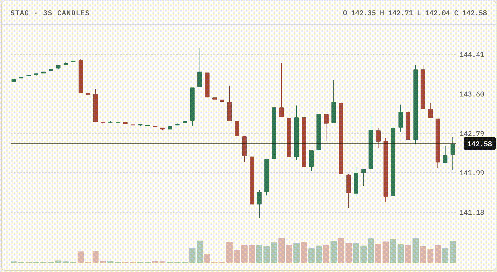

# Stag Market

A stock exchange simulation I wrote primarily in C++20, with Python bots and a minimalist, Scandinavian-inspired web UI. It trades one fictional stock, `STAG`, and the demo runs entirely in your browser via WebAssembly (see Design decisions below).

**[Live demo](https://sofiaksoder.github.io/stag-market/)**



**Stag Market** and **STAG stock** were inspired by the term "stag": a short-term trader who applies for new shares in an initial public offering (IPO) and flips them immediately when trading opens to capture a quick profit.

## Function

A stock exchange acts as a matchmaker for buyers and sellers, using an *order book* to queue and match trades. Incoming buy and sell orders sit in this queue until a buyer’s bid matches a seller’s ask, triggering an exchange. When multiple orders share the exact same price, the exchange follows a strict "first-come, first-served" (FIFO) rule based on time priority.

On a laptop (Intel i5-8257U, one thread), the engine adds a resting order in about 170 nanoseconds (p50) and handles about 5.7 million mixed operations per second.

## Trading guide

### The Trade tab

| Panel | What it shows |
| ----- | ------------- |
| **Header** | Last price and change for `STAG`. `IN SYNC` means your book matches the exchange's sequence numbers. `seq` is the latest message number and `msg/s` is feed rate. |
| **Order book** | Resting orders by price. Asks (sellers, red) are above the spread, bids (buyers, green) below. Sizes are in shares. The `MINE` columns show your own resting quantity at that price. |
| **Spread row** | `spread` = best ask − best bid. The bold number is the last trade price. `mid` is the midpoint of best bid and best ask. |
| **Chart** | 3-second candles (open, high, low, close) with volume bars underneath. |
| **Order ticket** | Where you place orders (account `SIM-01`). |
| **Open orders / Fills / Session log** | Your resting orders, your executions, and a log of events. |
| **Trades** | Every trade on the exchange. A dot marks trades that are yours. |

### Placing an order

1. Pick **Buy** or **Sell**.
2. Pick **Limit** or **Market**.
3. For a limit order, set the **Limit Price** with the `−` / `+` buttons or by typing. It starts at the mid price.
4. Set the **Quantity**, or use the 100 / 500 / 1,000 presets. Orders over 50,000 shares are rejected.
5. Check **Est. Notional** (price × quantity), then click the submit button, which reads like `Buy 100 @ 142.57`.

You can also click a price in the order book to fill the price in.

### Limit vs. market

**Limit:** trade at your price or better.
- If it crosses the spread (a buy at or above the best ask, or a sell at or below the best bid), it fills immediately.
- Otherwise it rests in the book. It appears under **Open Orders**, and your quantity shows in the `MINE` column at that price.

**Market:** trade immediately at the best available prices. You are guaranteed a fill (if there is liquidity) but not a price.

### Example

Book: best bid **142.54**, best ask **142.60**, spread **0.06**.

| Order | Result |
| ----- | ------ |
| Buy limit 100 @ **142.57** | Sits between the bid and ask. Rests as the new best bid. Fills only if a seller comes down to 142.57. |
| Buy limit 100 @ **142.60** | Matches the best ask immediately. |
| Buy limit 100 @ **142.40** | Rests below the best bid, far from the action. |
| Buy market 500 | Takes the best asks first (200 @ 142.60, 200 @ 142.61, then 100 @ 142.62), so your average price is above 142.60. |

### Reading your results (Portfolio tab)

| Field | Meaning |
| ----- | ------- |
| **Position** | Shares held. Positive is long, negative is short. |
| **Avg Price** | Average cost of your open position. |
| **Mark** | Last trade price, used to value your position. |
| **Unrealized** | Paper profit or loss on the open position: (Mark − Avg Price) × position. |
| **Realized** | Profit or loss locked in by closing positions. |
| **Net P&L** | Realized + Unrealized. Charted every 1.2 s. |

**Fill History** lists each execution (price, quantity, side, role, time). P&L uses average cost, marked to the last trade.

### Tips for newcomers

1. **Look at the spread first.** A market buy pays at least the best ask, so you give up half the spread or more immediately.
2. **Use limit orders by default.** Resting a bid at or just above the best bid costs nothing but patience.
3. **Check depth before sizing up.** If each level holds 200 shares, a 1,000-share market order walks five levels.
4. **Time priority matters.** At the same price, the earliest order fills first. Place early and don't re-price unnecessarily.
5. **Don't chase.** Fills at the edge of a fast move often reverse. Watch the candles and the Trades panel.
6. **Watch `Unrealized`.** It changes with every trade, but it only becomes real when you close the position.
7. **Check `IN SYNC`.** If it's not green, don't trust the book.
8. **Start with 100 shares** until you understand how fills and P&L behave.

### Stag-style trade

The project is named after *stagging*: buying at the open and selling quickly for a small gain.

1. Buy with a limit order near the best bid.
2. After it fills, place a sell limit a few ticks above your **Avg Price**.
3. If the market moves against you, cancel and exit rather than hoping.

One tick is $0.01, so a trade needs to clear the spread to be profitable. A two-tick spread requires more than two ticks of movement.

### Replay and Performance tabs

- **Replay** steps through a recorded session (`seed 42`) using the journal. Use `|◀`, `−1`, `▶ Play`, `+1`, `▶|`, and the 1× / 4× / 16× speed buttons. The book is rebuilt from the journal at each point, and the same journal always produces the same result.
- **Performance** shows benchmark results: latency histograms for add, match, and cancel, the wire-to-wire breakdown, and the optimization log.

## Purpose

This project began as a deep dive into the engineering behind modern financial exchanges. To understand how trade execution works on the backend, I built a matching engine from scratch. The project covers the full lifecycle of exchange architecture—from implementing price-time priority algorithms and high-performance data structures to benchmarking and measuring the engine's throughput.

## Design decisions

**Integer ticks instead of floats floats:** Prices are whole numbers of cents (1 tick = $0.01). Binary floating point can't represent many decimals exactly, so two prices that should be equal can differ by a tiny amount and a match gets missed. Integers compare exactly.

**Flat array of price levels:** By using a direct array index for each price level, the engine achieves O(1) constant-time lookups. This is a massive shift from my initial implementation, which relied on `std::map` and required O(log n) tree-traversal to locate a price.

**FIFO queue per price:** The best price goes first, and at the same price the earliest order goes first (price-time priority).

**Order pool:** Memory for orders is reserved at startup and reused instead of allocated per order. Allocation is slow and unpredictable, so avoiding it keeps latency steady.

**Deterministic Replay:** By logging every inbound action to a sequential journal, a fresh exchange instance can replay the log to reconstruct identical trades, order book states, and sequence numbers. This architectural choice provides three critical benefits:
• *Reliable Debugging*: Flaky or rare bugs can be reproduced perfectly and stepped through as many times as needed.
• *Regression Testing*: Real sessions can be recorded and replayed against new code updates to guarantee that outputs remain completely unchanged.
• *Auditability & Trust*: The sequential journal serves as an immutable audit trail, mirroring how production exchanges legally prove trade execution and state history.

### WebAssembly

Running the exchange would normally require setting up a local native toolchain, building a gateway, launching a backend daemon, and bridging it to a web UI. Recognising that local environment friction would prevent most visitors from trying the demo, I compiled the core C++ matching engine directly to WebAssembly (Wasm). This shifts the entire application to the client side, allowing the exchange to run with near-native performance entirely within the user's browser, no setup required.

The tradeoff: the browser demo is one user against simulated bots. The TCP and WebSocket gateway is still there for running Python bots against a live engine.

## Value

From `stag_bench`, Release build, one thread, 200,000 orders, best of 3 runs. Clock reads (about 59 ns) are included in every figure.

| Op | p50 | p99 |
| --- | --- | --- |
| add (resting) | 169 ns | 387 ns |
| add (match + fill) | 182 ns | 412 ns |
| cancel | 257 ns | 491 ns |

One resting order over loopback TCP, send to ack, takes about 35 µs at p50. The engine (decode, book, encode, publish) is roughly 1% of that. The rest is the kernel and the socket.

What each change bought, on the same workload:

| # | Change | Add p50 | Throughput | vs. baseline |
| --- | --- | --- | --- | --- |
| 1 | `std::map<Price, std::list<Order>>` | 269 ns | 2.1M/s | 1.0x |
| 2 | flat level array + intrusive FIFO + order pool | 174 ns | 3.0M/s | 1.4x |
| 3 | open-addressed id map instead of `std::unordered_map` | 169 ns | 5.7M/s | 2.7x |

The surprise was step 3. Latency barely moved (174 to 169 ns), but throughput nearly doubled. `std::unordered_map` allocates a node per entry and chases pointers, so I suspect cache misses and allocation were the cost under sustained load. An open-addressed table keeps everything in one contiguous block.

## Architecture

```
Python bot ──TCP──▶ ┌──────────────────────────────┐ ──TCP────▶ market-data client
Browser    ──WS───▶ │ gateway: poll loop, decode,  │ ──WS─────▶ Browser
                    │ risk check, exchange, book,  │
                    │ market-data publisher        │
                    └──────────────┬───────────────┘
                                   ▼
                          journal (append-only) ──▶ replay
```

Everything runs on one thread for now.

- **Book:** flat array of price levels per side, an intrusive FIFO per level, orders from a preallocated pool. Limit and market orders, cancel, modify.
- **Gateway:** binary protocol (`NewOrder`, `Cancel`, `Ack`, `Fill`) over TCP and WebSocket, or in the page through WebAssembly. Orders over 50,000 shares are rejected.
- **Market data:** every message has a sequence number that goes up by one. Level deltas carry the new size, trades come with the aggressor side, and a snapshot is sent on connect or on request. A client that sees a gap freezes its book, asks for a snapshot, and replays the deltas it buffered.
- **Journal:** every order, cancel and disconnect is written with its timestamp.

## Build and test

```bash
cmake -S . -B build -DSTAG_SANITIZE=ON && cmake --build build
./build/order_book_test && ./build/gateway_test && ./build/ws_test && ./build/journal_test && ./build/wasm_api_test
cd web && bun install && bun run test    # npm works too
```

## Run it

```bash
./build/stag_gateway 9000        # orders on 9000, market data on 9001, WebSocket on 9002
python3 bots/bot.py 9000 10      # trades for 10s
python3 bots/md_client.py 9001   # watches the feed (--lossy drops messages to test recovery)
cd web && bun install && bun run dev   # UI on http://localhost:5173
```

**Browser-only demo (WebAssembly):**

```bash
cd web && VITE_DEMO=wasm bun run dev
```

**Record and replay a session:**

```bash
./build/stag_sim 42 2000 session.journal                    # seeded session
./build/stag_replay session.journal web/public/replay.json  # snapshot every 500 ms
```

Then open the Replay tab.

**Benchmark:**

```bash
cmake -S . -B build-rel && cmake --build build-rel
./build-rel/stag_bench web/public/perf.json
```

## Layout

| Dir | Contents |
| --- | --- |
| `engine/` | order book and id index |
| `gateway/` | wire protocol, exchange glue, market-data publisher, journal, WebSocket, TCP server |
| `tools/` | seeded session generator and journal replay |
| `wasm/` | the engine behind a C API for the browser, and its build script |
| `bench/` | benchmark and the `std::map` baseline book |
| `bots/` | Python bot, market-data client, WebSocket probe |
| `web/` | React + Vite UI |
| `tests/` | order book, gateway, WebSocket, journal and WebAssembly API tests |

> Simulated market. Not financial software.
